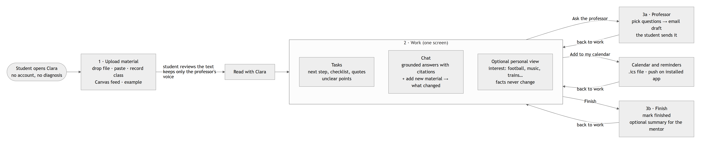
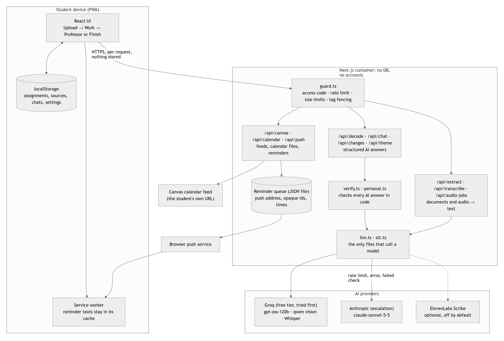

# Clara

**Clara turns ambiguous course instructions into clear, checkable steps for autistic and ADHD university students. When something is missing, it asks instead of guessing.**

Built for the [North American AI Challenge 2026](https://tech.asu.edu/na-ai-challenge) (Spark Center for Innovation in Learning, ASU), Monterrey Launchpad, with the Challenge Partner **Surfeando la Neurodiversidad** (Mentoring and Student Wellbeing, Tec de Monterrey).

- **Live app:** [FILL: public URL and access code for judges]
- **Demo video:** [FILL: shared link to `clara-demo-en.mp4`]
- **Pitch deck:** [FILL: Google Slides URL]

## What it does

A student uploads what a course gave them: the brief, the rubric, a class recording, an announcement. Clara then:

1. **Shows what is asked, with proof.** Each deliverable, date and criterion carries a word-for-word quote, and code checks that the quote is really in the source.
2. **Asks instead of guessing.** What is missing, vague or contradictory becomes a question and an email draft for the professor. The student sends it.
3. **Gets the student started.** Small steps with a visible "done when", a calendar file and reminders.
4. **Explains through what the student loves.** Football, music or trains can shape names, figures and labelled analogies. Quotes and dates do not change.
5. **Never writes the assignment** and never sends anything by itself.



## Run it

Requires Node.js 22 or newer (Node 24 to run the tests). At least one AI key is needed: `GROQ_API_KEY` (free tier) or `ANTHROPIC_API_KEY`.

```bash
cd clara
npm install
cp .env.example .env     # add your keys
npm run build && npm start   # http://localhost:3000
```

Click **Try an example** to run the whole flow on synthetic material. Full setup, deployment and test commands are in [`clara/README.md`](clara/README.md).

## Architecture



Next.js 15 and TypeScript in a container. No database and no accounts: student work stays on the device. All eight diagrams are in [`docs/diagrams/`](docs/diagrams/README.md).

## Where things are

| Path | Contents |
|---|---|
| [`clara/`](clara/) | The app, tests, benchmark, [`README`](clara/README.md) and [`ATTRIBUTION`](clara/ATTRIBUTION.md) |
| [`clara/src/prompts/index.ts`](clara/src/prompts/index.ts) | Every system prompt |
| [`docs/`](docs/README.md) | Research, decisions, business model, code walkthrough |
| [`docs/16_current_state.md`](docs/16_current_state.md) | What works today, how it was verified, what is still open |
| [`submission/`](submission/README.md) | Deck, Business Model Canvas, prompts PDF, written responses, review checklist |
| `raw/` | Challenge kickoff material and original idea notes |

## Results so far, and their limits

Latest benchmark (Nov 4, 2026; five **synthetic** briefs, one run, judged by a model from the same family, so directional only):

| Measure | Clara | Same model as a plain chatbot |
|---|---|---|
| Unclear points flagged | 16/19 | 9/19 |
| Specific values invented or assumed | 1 | 2 |
| Briefs where it wrote assignment content | 0/5 | 2/5 |

An Oct 27 run of an earlier version scored 19/19 vs. 13/19; results vary between runs and providers. **Clara has not yet been measured in a usability study with autistic students.** That is the next step.

## AI assistance

This project was built with substantial help from Claude Code (Anthropic), directed and reviewed by the team. What was generated, what is third-party and who reviewed each module is in [`clara/ATTRIBUTION.md`](clara/ATTRIBUTION.md).

## Team

Those Men of Hack: Arturo Cruz, Francisco González, Hugo Pérez.
