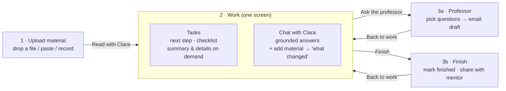
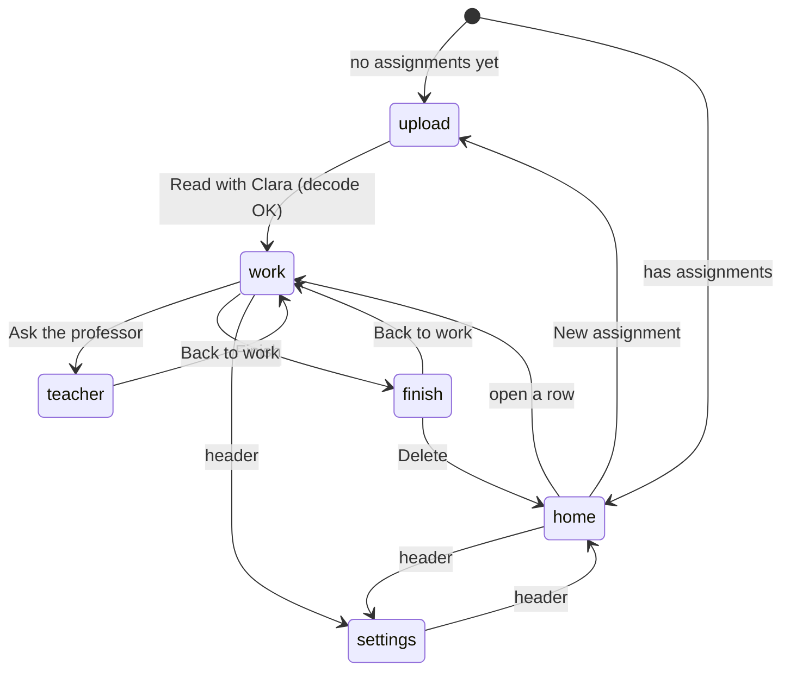
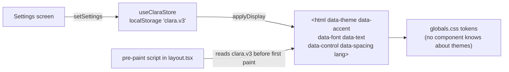
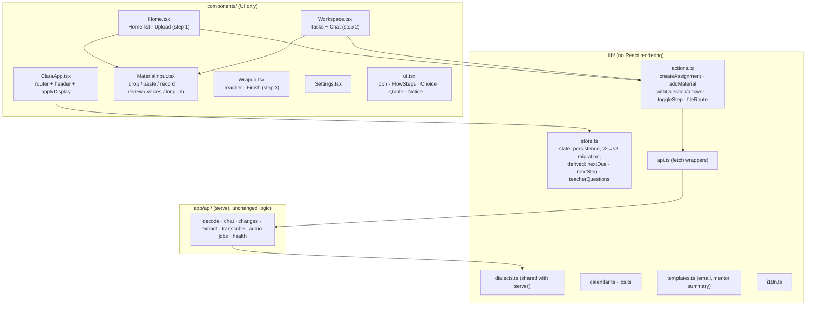
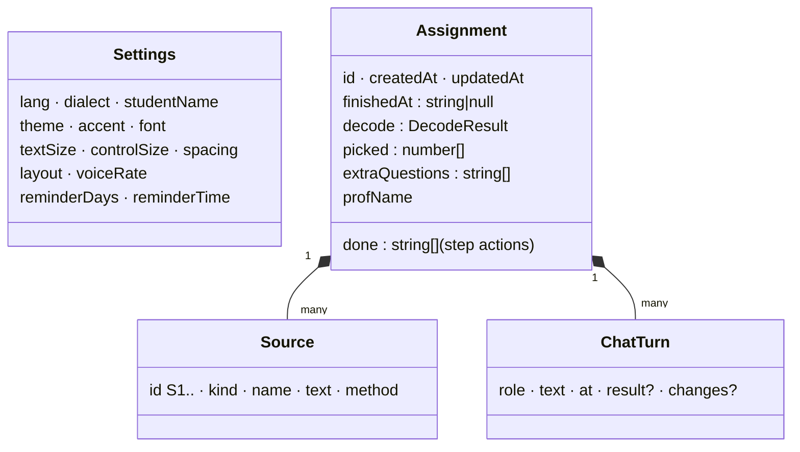

# 14 · Clara v3: simpler, calmer, adjustable

**Date:** 2026-11-04 · **Branch:** `hugo` · **Scope:** `clara/src` (UI layer rewritten, server mostly unchanged)

## 1. Why

Clara is for autistic and ADHD students who are already overloaded. v2 worked, but the student had to deal with:

- **4 top-level sections** (Today, Assignments, New, Settings) plus a dashboard with 4 panels
- **8 tabs per assignment** (Summary, Hand in, Questions, Steps, Ask, Calendar, Changes, Mentor)
- **5 ways to add a source** (paste, PDF/photo, audio, transcript, Canvas), each with its own form and a "what is it?" picker
- one bright, white theme, with no way to change size, colours or font

Every one of those is a decision the student has to make before doing any work. v3 turns the app into **one path**, makes the **dark theme the default**, and moves **every visual preference into Settings**.

## 2. The flow



A three-step indicator (`Upload material › Work › Professor or finish`) is shown on every assignment screen, so the student always knows where they are and what comes next.

A first-time student lands directly on **Upload** (there is nothing to look at in an empty list). After that, the app opens on **My assignments**.

### App state machine (`components/ClaraApp.tsx`)



The whole router is one `useState<View>`. No URL routing, no tab state, no nested views.

## 3. What was cut, merged or kept

| v2 feature | v3 | Why |
|---|---|---|
| Today dashboard (next step, upcoming, questions, value pitch) | **Merged** into the assignment list + the "Next step" card inside Work | Same information, one place. The marketing panel was for judges, not students. |
| Assignments list | **Kept** as Home; finished ones collapse under "Finished (n)" | Less to scan. |
| 8 tabs | **3 steps**: Work, Professor, Finish | See rows below. |
| Summary tab | **Collapsed** ("In short") inside Tasks | The next step matters more than a summary. Still one click away and still read aloud. |
| Hand in tab (dates, deliverables, format, grading with quotes) | **Collapsed** ("Dates, deliverables and format") inside Tasks | Kept every quote and the code check; only hidden until asked. |
| Steps tab | **Is** the Tasks panel | It is the core of the work view. |
| Ask tab | **Is** the Chat panel, beside Tasks | The requested "see tasks and talk to the agent in the same tab". |
| Changes tab (paste new version → compare) | **Merged into chat**: "+" in the composer adds material; Clara posts "What changed / What you need to do" as a chat message | One place to add things, and the change shows up where the student is already looking. Done steps survive the re-read (stored by text, not index). |
| Questions tab + email draft | **Step 3a: Professor** | It is an exit from the work, not a parallel task. |
| Mentor tab + "where do you feel stuck" note | **Optional, collapsed** in Step 3b: Finish | Partner-relevant (surfers), but not everyone has a mentor. Note field removed. |
| Calendar tab (event list + per-event Google links) | **One button** in the Work header: "Add to my calendar" (.ics) | The .ics already works with Google, Apple and Outlook. Reminder days and time stay in Settings. |
| Sources cross-check panel ("n facts backed" per source) | **Cut**. Material is listed under "Your material (n)" with its full text | The verified count stays as one line in the summary. |
| 5 source methods + kind picker on each | **One drop zone**: the file type picks the route; paste and record are two buttons; kind is a single `<select>` on reviewed text only | 1 decision instead of 2–3. Audio and transcripts are always "Said in class". |
| Canvas calendar-feed import | **Removed** (`/api/canvas`, demo feed and its parser test deleted) | Needed a URL from deep in Canvas settings; copying the brief into Clara is simpler. **Restored 2026-11-04** at the user's request as one more option in the intake, as planned below, plus a field in Settings. |
| Install-the-app section | **Removed** from Settings | The browser offers it already. The service worker and manifest stay. |
| Speaker picker (keep only the professor's voice) | **Kept** | Privacy-critical: other voices never reach the model. |
| Whole-class audio job | **Kept** | Server pipeline unchanged; only the UI moved into the intake component. |
| Read aloud | **Kept**, speed now adjustable | |

## 4. Settings: display and accessibility

All preferences apply immediately and stay on the device.

| Setting | Options | Mechanism |
|---|---|---|
| Theme | **Dark** (default) · Light · High contrast | `html[data-theme]` → colour tokens |
| Accent colour | Blue · Teal · Yellow · Violet · Rose | `html[data-accent]` → `--accent`, tuned for each theme |
| Typeface | Atkinson Hyperlegible (default) · Lexend · System font | `html[data-font]` → `--font-body` |
| Text size | Small 15px · Normal 17px · Large 20px · Extra large 23px | `html[data-text]` sets the root size; all CSS is in `rem` |
| Button and field size | Normal · Large · Extra large | `html[data-control]` → `--control-h` (min 44px), `--gap` |
| Line and letter spacing | Normal · Wide | `html[data-spacing]` → `--lh` 1.55→1.85, letter and word spacing |
| Workspace | Tasks left / chat right · swapped · stacked · one at a time | `.work[data-layout]`; below 900px it is always one at a time with a switch |
| Language | Español · English | UI strings (`lib/i18n.ts`) |
| Regional variant | es: México, Estados Unidos, Colombia, Argentina, España · en: United States, Canada, United Kingdom | Date format, reading voice, **and the AI's wording** (see §6) |
| Read-aloud speed | Slow · Normal · Fast | `SpeechSynthesisUtterance.rate` |
| Reminders | 7/3/2/1 days before, time | Used when the .ics is built |



The pre-paint script means a student who chose Light + Extra large never sees a flash of dark, small text on reload.

### Accessibility checklist (what the code does)

- **Contrast:** every text/background pair in every theme and accent was computed (72 pairs). Minimum 5.6:1. High contrast ≥ 7:1 (WCAG AAA). Red is used only for real problems.
- **Calm:** no animation or transition anywhere (`animation: none` globally), no shadows, no gradients, one accent colour per screen.
- **Keyboard and screen readers:** skip link; every screen change moves focus to its `<h1>`; settings use native radio buttons inside `<fieldset>/<legend>`; status messages are `aria-live`; errors use `role="alert"`; icon-only buttons have labels; the flow uses `aria-current="step"`.
- **Targets:** buttons and fields are at least 44px high, more at Large/Extra large.
- **Reading:** Atkinson Hyperlegible or Lexend; adjustable size and spacing; read-aloud on the next step and the summary.

## 5. Code structure



Rules that keep it simple:

1. **Components render; `lib/actions.ts` thinks.** Every AI flow is a plain async function `(assignment, …) → next assignment`. A component calls it and saves the result with `store.upsert`. No component builds API payloads.
2. **One intake.** `MaterialInput` is used by Upload and by the chat's "+". Every route ends with text the student has seen (reviewed text, chosen voices, or chosen passages).
3. **Derived values are functions, not state.** `nextStep`, `isDone`, `teacherQuestions`, `nextDue`, `byDue` live in `store.ts`.
4. **Themes are CSS only.** Components never read the theme; they use tokens.

### Size

| | v2 | v3 |
|---|---|---|
| UI components (`src/components`) | 1,727 lines in 5 files | 1,337 lines in 7 files (−23%) |
| Screens/tabs a student can reach | 4 sections + 8 tabs | 3 steps + home + settings |
| Ways to add material | 5 forms | 1 drop zone + paste + record |

## 6. Data model and server changes



- **Storage key** `clara.v2` → `clara.v3`. On first load v3 migrates v2 data: drops undecoded drafts, converts done step indexes to step texts, maps old Canvas sources to "paste". The old separate `changes` log is not carried over.
- **`done` stores step text, not indexes**, so a re-read after new material keeps the progress on steps that still exist (v2 reset everything).
- **"What changed" lives in the chat** as a `ChatTurn` with `changes`. It is skipped in the history sent to the chat model.
- **Server:** `/api/decode`, `/api/chat` and `/api/changes` accept an optional `dialect`. `outputLanguage()` in `lib/dialects.ts` maps it to a fixed phrase ("Spanish as written in Mexico", "British English"…) from a whitelist; any other value falls back to the language default, so free text never reaches the prompt (unit-tested). `LANGUAGE_NAME` was removed. `/api/canvas` was deleted.

### Request path when the student adds an announcement during work

```mermaid
sequenceDiagram
    actor S as Student
    participant C as Chat panel
    participant A as actions.addMaterial
    participant D as /api/decode
    participant X as /api/changes
    S->>C: "+" → paste announcement → Add
    C->>A: addMaterial(a, source, voice)
    par
      A->>D: all sources + dialect
      A->>X: before vs after + dialect
    end
    D-->>A: new decode (quotes checked)
    X-->>A: what changed / what to do
    A-->>C: assignment with new decode, kept steps, chat note
    C->>S: "You added: …" note in the chat; tasks update beside it
```

## 7. Verification (2026-11-04)

| Check | Result |
|---|---|
| `npx tsc --noEmit` (app code) | clean |
| `npm run build` | passes |
| `npm test` | **30/30** (26 existing; Canvas feed test removed with the feature; 4 new dialect tests) |
| `node tests/e2e-flow.mjs` with real AI, phone + desktop | **10/10**: dark default, example decoded, contradiction flagged, chat answers from the class transcript, added material produces a change note with the moved date, professor email drafted, finish, theme switches live, tasks and chat side by side on desktop, no horizontal overflow. 0 page errors. |
| Contrast script (all themes × accents) | 72/72 pairs pass, min 5.6:1 |
| Browser console | 0 errors, 0 warnings |

**Not verified:** `tests/e2e-long-class.mjs` (updated to the new UI but not run: needs a long recording), screen-reader testing with real NVDA/VoiceOver, and testing with students from the partner program. (`eval/record-demo.mjs`, which drove the v2 UI, was later removed; the demo videos are now made outside the repo.)

## 8. Open decisions for the team

- **Canvas import:** removed for simplicity. If the partner says students rely on it, bring it back as one more option inside the drop zone, not as a separate form.
- **Regional variants in UI labels:** labels are neutral Spanish/English; the variant affects dates, the reading voice and the AI's wording only. Full localized labels (e.g. voseo for es-AR) would mean a second string table per variant.
- **Mentor share placement:** now only at Finish. If surfers want mid-assignment check-ins, it could also be offered from the Professor step.
